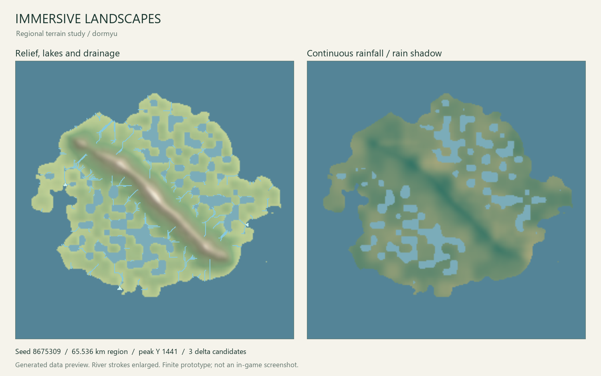

# Immersive Landscapes

**Mountain ranges. Connected watersheds. Room for an expedition.**

An original terrain project by **dormyu** for Minecraft running on the **Horizon
Rust client and Rust server**. The aim is large mountain massifs and foothills,
continuous climate transitions, and water that belongs to a connected landscape.

> **Experimental native mod — visual acceptance is still open.**
> The generator has been built into Horizon and tested in real single-player worlds
> with Distant Horizons. The current terrain prototype was rejected visually;
> it is not a recommended release. Seamless regions, final near/far consistency,
> two-client integration and a representative performance budget remain open.



*A map exported by the generator, not a Minecraft screenshot. The preview is a
bounded region; river strokes are exaggerated for visibility.*

## What runs today

- A coherent curved mountain belt with broad foothills and separate massifs.
- Continuous temperature, rainfall and moisture fields, including a rain shadow.
- Priority-flood drainage with connected oceans, inland basins and lake spill levels.
- Accumulated runoff, converging tributaries, river widths, depths and floodplains.
- Preliminary distributary fans at low-gradient mouths. These are geometry
  candidates, **not a sediment, tide or erosion simulation**.
- An immutable surface sampler that carves river beds and banks, keeps lakes
  level, and queries a spatial index instead of scanning all rivers per column.
- Deterministic tests for flow conservation, confluences, depressions, actual
  distributary creation, rejected delta sites, channel geometry and boundaries.

Drainage is compiled once for a region. Terrain queries do not simulate fluids
or solve the watershed again. The native adapter feeds nearby chunks and distant
terrain from that same landscape. Its current far columns still need layered
materials and vegetation.

## Try the core

Requires Rust 1.85 or newer. The runtime crate has **no third-party dependencies**.

```sh
cargo test --locked
cargo run --release -- --seed 8675309 --side 257 --cell-size 128 --output output/demo
```

Outputs are `terrain.csv`, `rivers.csv`, `deltas.csv` and `summary.json`.
The default grid spans 32.768 km; one terrain metre is intended to correspond
to one block. Grid resolution is a regional calculation setting, not a block size.

For a larger example with the same grid memory budget:

```sh
cargo run --release -- --seed 8675309 --side 257 --cell-size 256 --output output/large
```

Optional development map (Python and Pillow are only for this tool):

```sh
python -m pip install -r tools/requirements-preview.txt
python tools/preview.py output/large --output docs/images/terrain-preview.png
```

Keep `CARGO_HOME`, `RUSTUP_HOME`, `CARGO_TARGET_DIR` and temporary directories on
a drive with sufficient space. A single Cargo build job reduces compilation
memory pressure; it does not control the generator's eventual worker budget.

## Direction

Mountains should be large enough to change route planning. Building, including
block pillars, remains valid. The landscape supplies scale and geography;
progression can supply better travel tools later.

Solo play must work. Two to four players are the intended cooperative scenario.
World generation will be authoritative on the Rust server, shared by all players;
changing the party size must not regenerate the terrain. Combat difficulty
scaling belongs to the wider modpack, not this generator.

See [architecture and current limits](docs/architecture.md),
[roadmap](docs/roadmap.md) and [contributing](CONTRIBUTING.md).

The detailed [playable-mod implementation plan (Russian)](docs/implementation-plan.ru.md)
defines integration gates, visual acceptance and performance measurements. The
[implementation handoff](docs/next-agent.md) records the next concrete task.

## Compatibility and related work

The native integration target is Horizon Nightly `c9d474d` / Minecraft 26.3.
See [native build notes](docs/native-build.md) for the pinned tool patch and
combined build. A native bundle requires compilation; copying it beside the
game executable does not activate its Rust code.

Epic Terrain's MIT worldgen data has also been adapted and loaded as an independent
reference in Horizon. [Reference findings](docs/reference-findings.md) distinguish
that comparison fixture from our generator and describe the remaining DH issues.

Distant rendering is a separate dependency. The modpack's adaptation of
[Distant Horizons for Horizon Client](https://github.com/denizsahin7744/distant-horizons-for-horizon-client)
is developed separately under its own LGPL license. Its source is not included
or relicensed as part of this MIT terrain core. DormCore may become a small
shared library when multiple mods actually need it.

Original code here is [MIT licensed](LICENSE). See [credits and inspirations](CREDITS.md).
Minecraft belongs to Mojang/Microsoft; this is an independent community project.
No game assets, prepared resources, accounts or worlds are distributed here.
