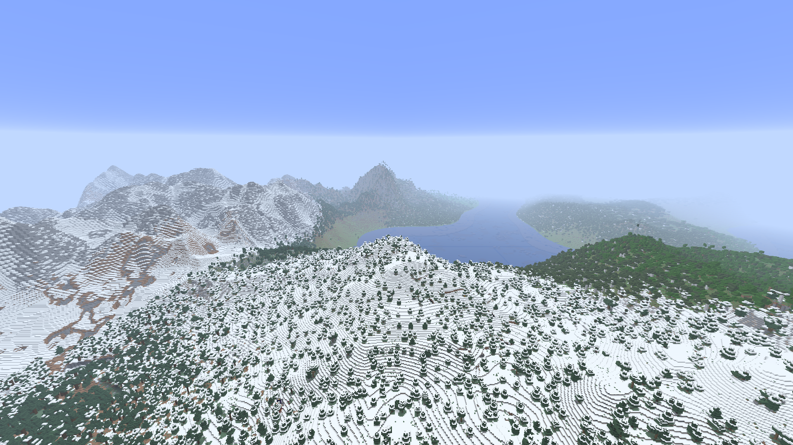

# Immersive Landscapes

Minecraft landscapes with mountain ranges, rivers and varied biomes at a scale
suited to exploration and a fantasy survival pack. By **dormyu**.

This is a native mod for the **Horizon Rust client and Rust dedicated server**.
The current candidate uses Epic Terrain's complete MIT generation recipes,
adapted to Horizon and tuned for smaller climate regions. Original authorship
and every data change are recorded in [CREDITS](CREDITS.md).

> Experimental. The earlier height-only prototypes were rejected visually.
> Version `0.2.0-dev.1` replaces that approach; visual acceptance, matching
> distant terrain and the final performance budget are still being checked.

Actual native-game capture, seed8675309, near16 and Distant Horizons128 medium.

## How it works

Create a normal world, choose a seed, and play. The mod installs its generation
recipe before Horizon loads the world's dimensions and biome registries.
There is no prepared world to copy and no manual data-pack selection.

Horizon generates the complete terrain, caves, ores, biomes, trees, plants and
structures. The preset keeps Epic Terrain's original mountain and river scale;
its temperature and moisture wavelengths are four times shorter by default.
The old fourfold mountain amplification and bounded experimental island are gone.

Existing vanilla worlds retain their generator. Each new IL world keeps its own
installed recipe, so changing a later pack default does not change that world.
Archived prototype worlds require their pinned experimental build.

Distant rendering is provided separately by the modpack's adaptation of
[Distant Horizons for Horizon Client](https://github.com/denizsahin7744/distant-horizons-for-horizon-client).
Near distance and distant LOD distance are separate settings. The aspiration is
32 actual near chunks at 120 FPS, with far terrain and room for a heavy pack;
this is a target, not a claimed result.

## Build and tuning

The native integration targets Horizon Nightly `c9d474d` / Minecraft 26.3.
See [native build notes](docs/native-build.md). A `.hnmod` must be compiled into
Horizon; copying a source bundle beside the executable does not activate it.

[The preset](presets/epic-compact/IL-PRESET.json) records its source and tuning.
An optional `<game>/horizon-mods/immersive-landscapes-preset` directory can supply
an external preset for newly created worlds without recompilation. Existing
worlds keep their saved data pack.

The standalone Rust drainage library and map tools under `src/` and `tools/`
remain research code. They do not replace the current native generation pipeline.
See [current handoff](docs/next-agent.md) and [reference findings](docs/reference-findings.md).

[Measured validation and known limits](docs/validation-0.2.0-dev.1.md) distinguish
actual native-game checks from the standalone research-library tests.

Own code is [MIT](LICENSE). Epic Terrain's data retains its own MIT notice;
Distant Horizons remains a separate LGPL project. No game assets, prepared
resources, accounts or worlds are distributed here. Minecraft belongs to
Mojang/Microsoft; this project is independent and not endorsed by them.
