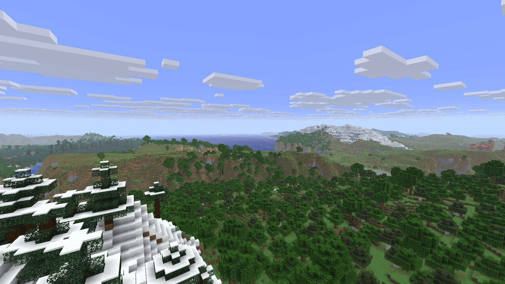

# Immersive Landscapes

Familiar Minecraft terrain with more coherent mountain regions and graded river
valleys. A native mod for the **Horizon Rust client and Rust dedicated server**,
by **dormyu**.

> **Working version · active development.** `0.3.0-dev.2` generates playable worlds
> through the normal **Immersive Landscapes** world type. World creation,
> save/reopen, two Rust clients and the installed Prism build have been tested.
> Known distant-rendering issues and unfinished generation features are listed below.

## What changes

The new `vanilla-natural-v1` overlay keeps the normal generator's continents,
climate scale, height limits, biomes, trees, plants, caves, ores and structures.
Six density functions adjust shared terrain fields:

- A broader component connects mountain regions while retaining local variation.
- Eroded lowlands have wider valley profiles; mountain passes stay narrower.
- Inland river floors are protected against excessively deep slots, fading out
  before ocean terrain. The original coast and ocean recipe remain the foundation.
- Terrain shape and biome selection use the same ridge/erosion fields.

This is a small overlay on vanilla generation. It replaces the earlier full
Epic Terrain preset for **new worlds**. Existing v4 worlds keep their own
Epic-derived recipe; they are not converted to the new landscape.

Noise valleys are **not** a physically simulated drainage network or validated
river deltas. Vanilla biome identities and vegetation boundaries remain discrete.
These are open development areas, not completed features.

## Create a world

Run a Horizon build compiled with this mod, keep it enabled, and choose world
type **Immersive Landscapes**. Enter any seed and create the world normally.
There is no prepared save or manual data-pack selection. New worlds receive a
descriptor identifying `vanilla-natural-v1` and their own recipe.

The local project laboratory is **DormLab**. **DormLab-EpicReference** is a
different comparison instance with IL disabled; ordinary new worlds there use
vanilla generation. Its prepared Epic world does not change other worlds.

Old vanilla worlds retain their generator. IL v4 and v5 worlds retain their saved
recipe. Archived v1–v3 prototypes require their pinned experimental build.

## Build and performance

The integration targets Horizon Nightly `f42ef42` / Minecraft 26.3. A `.hnmod`
must be compiled into Horizon; copying the bundle beside an executable does not
activate it. See [native build notes](docs/native-build.md), the
[current handoff](docs/next-agent.md), [generation details](docs/vanilla-natural.md)
and [measured checks](docs/validation-0.3.0-dev.2.md).

Terrain changes run during generation; this mod adds no gameplay-frame callback.
Distant rendering is supplied separately by the pack's adaptation of
[Distant Horizons for Horizon Client](https://github.com/denizsahin7744/distant-horizons-for-horizon-client).
Actual near chunks and DH distance are separate settings. A short warmed-world
test at 1080p, 32 near chunks and DH128 Medium measured 120 FPS stationary and
119.6 FPS in flight, with a maximum flight frame of16.8ms (offscreen, VSync/audio
off). Long exploration and headroom for a heavy pack still need verification.

## Known issues and ongoing work

- The combined build still has visible near/far water boundaries. Floating distant
  terrain has also been reported and is being compared against full-detail chunks.
- Connected catchments, validated river outlets/deltas and gradual vegetation
  transitions are unfinished. The working terrain overlay does not implement
  those systems yet.
- Existing worlds retain their saved recipe. Future generation changes will need
  explicit versioning; they must not silently reshape explored worlds.

[Preset metadata](presets/vanilla-natural/IL-PRESET.json) records changes and
checksums. Optional external tuning is copied only into new worlds. The standalone
drainage library in `src/` remains research and does not drive the current game.

Own code is [MIT](LICENSE). Historical Epic Terrain data retains wonderfulaichen's
MIT notice; DH is a separate LGPL project. See [CREDITS](CREDITS.md). No game assets,
prepared resources, accounts or saves are distributed. Minecraft belongs to
Mojang/Microsoft; this project is independent and not endorsed by them.

The local DormLab set also includes the separate official Horizon Zoom mod; see
[the current profile and validation](docs/dormlab-zoom-2026-11-03.md).
