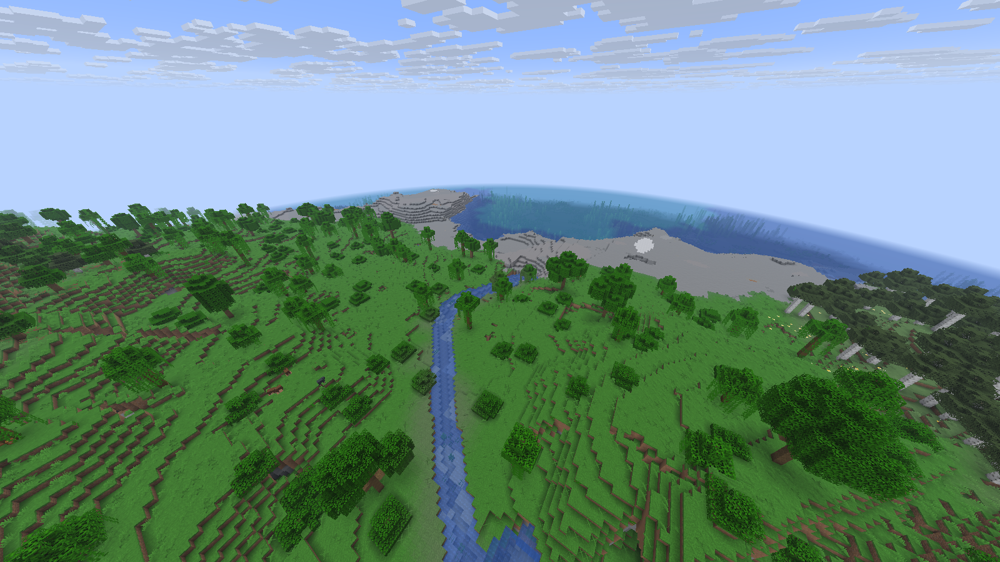
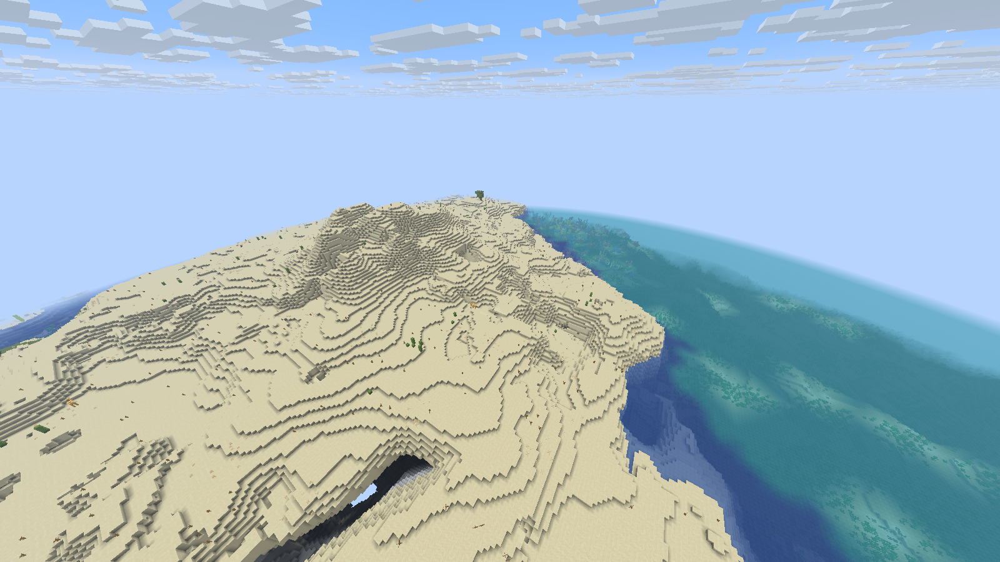
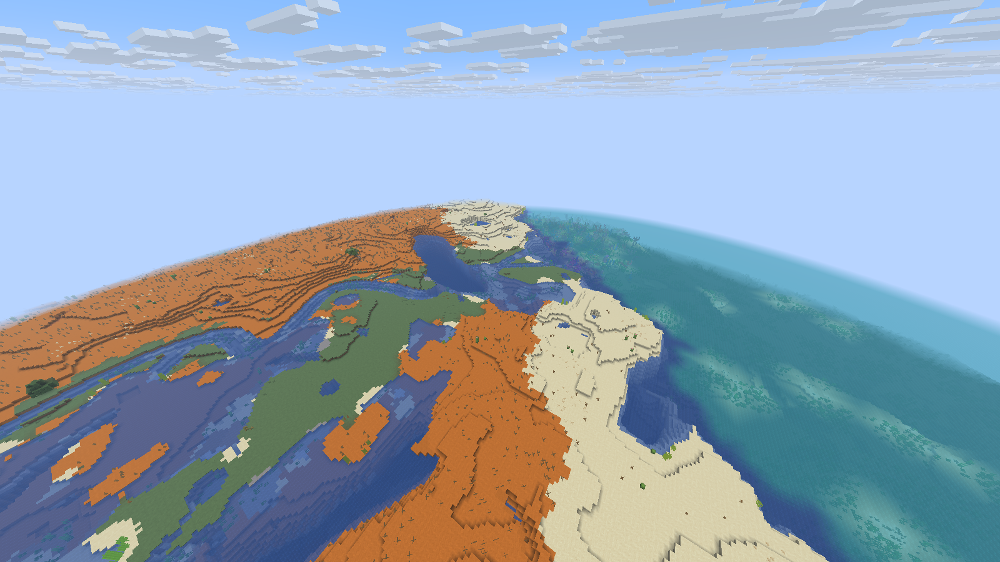
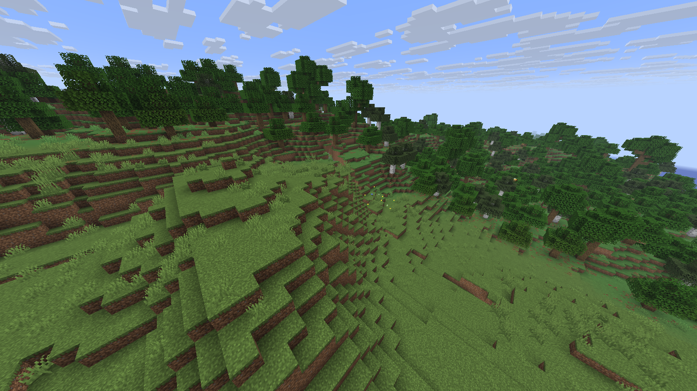
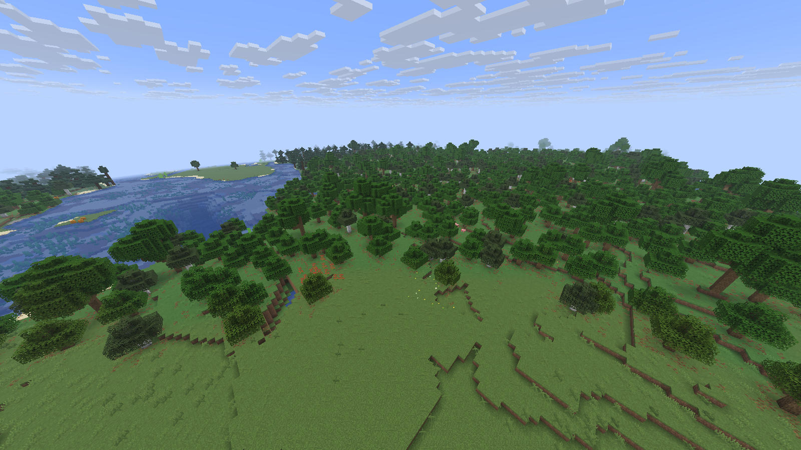
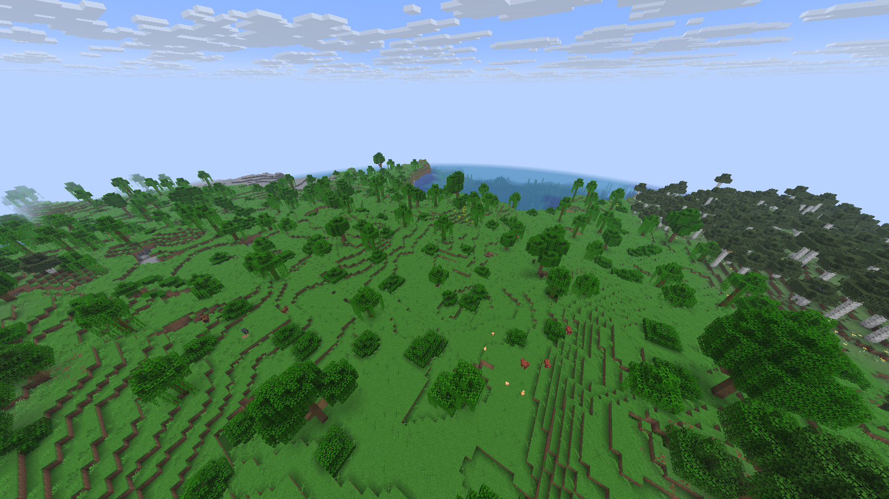
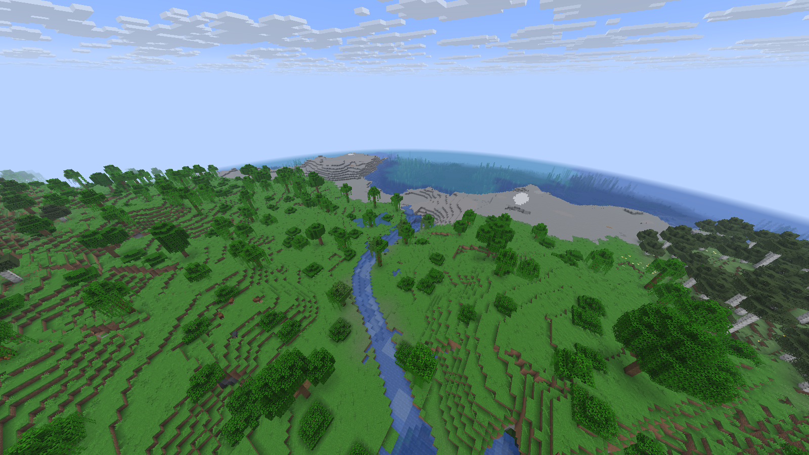
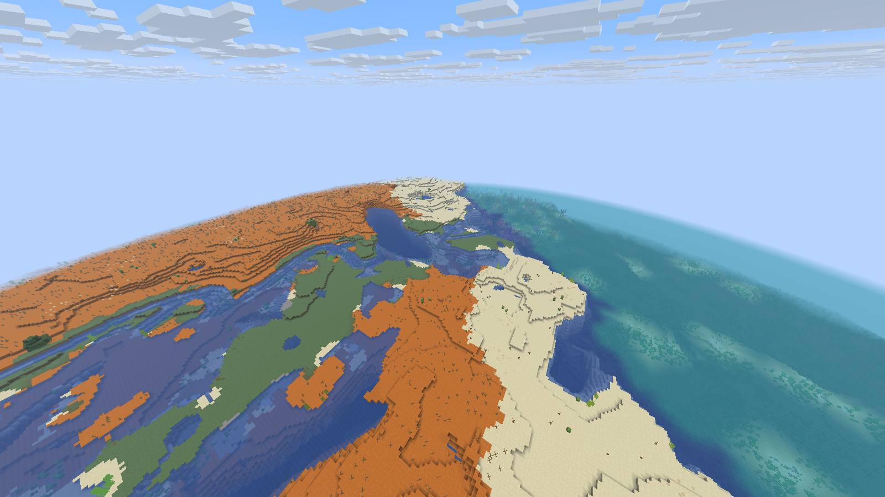
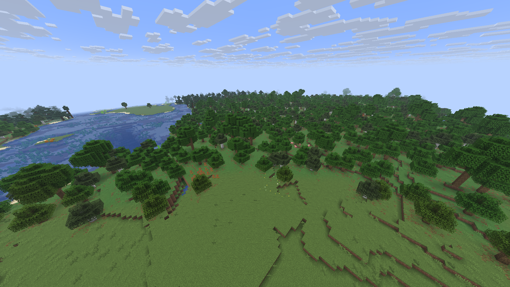

# Immersive Landscapes

<!-- CURRENT-DH17-DELIVERY -->
**Working release: Immersive Landscapes 0.6.0**, paired with
[Distant Horizons dormyu.17](https://github.com/dormyu/distant-horizons-for-horizon-client/releases/tag/dormyu.17) and official Zoom 2.
The latest renderer update restores supported distant tree stems and blends
water colours. Existing worlds keep their saved generation recipes.

Solo, save/restart, two Rust clients and the installed Prism launch are checked.
Performance tests for this update were omitted at the owner's request; underwater
LOD detail and lighting still have visible differences. See [validation and
remaining limits](docs/renderer-dormyu.17.md) and [native build instructions](docs/native-build.md).

Familiar Minecraft terrain with connected mountain regions, rivers that follow
their catchments, and gradual vegetation transitions. A working native mod for
the **Horizon Rust client and Rust dedicated server**, by **dormyu**.

**0.6.0 — refined rivers and regional vegetation.**
New worlds use **descriptor 11 / `vanilla-natural-v7`**. River bends, bank grading
and connected outlets are refined, and compatible snowy, dry, tropical and
wetland vegetation joins the existing temperate/cool transitions. The current
optimized client passes solo/save/restart, two-client, native generation and
bounded river/DH checks. The same-camera vanilla/IL comparison is shown below.
See [validation](docs/validation-0.6.0.md) for exact runtime evidence and limits;
final installation, Prism and distribution readback belong to release notes.

## Generation

The recipe keeps Minecraft's scale, continents, climate, height limits and gameplay
biome identities. Shared ridge, erosion and valley fields shape broader mountain
regions and connected lowlands. Native caves, ores and structure definitions
remain in use. Villages are not redesigned by this version.

Bounded catchments supply tributaries, shared confluences, suitable inland lake
receivers and conservative coastal distributaries. Meanders preserve downstream
progression and shared junctions. Bank grading softens suitable high shores;
dry margins do not manufacture extra water or cut a high native shore beneath
the planned waterline. Bounded stepped outlets connect without raising the
receiving lake. Native cavity bottoms are preserved even when distant surface
approximations cannot reproduce their full depth.

Vegetation changes gradually across six compatible climate neighborhoods:
temperate, boreal, snowy/alpine, dry/warm, tropical and wetland. Native placement,
soil and climate rules remain active; overlapping donors do not simply stack two
full vegetation densities. Special pale-garden/mushroom vegetation and aquatic,
cave and foreign biomes retain their native behavior. Gameplay biome IDs remain
unchanged. See [generation and saved recipes](docs/vanilla-natural.md).

## Same seed, same camera — 0.6.0

Separate fresh vanilla and IL worlds, seed `4312740467388825473`, captured with
the same frozen optimized 0.6.0 client, cameras, noon/clear weather,1600×900,
configured base FOV90, actual distance16 and DHoff. Random block ticks are disabled.
All six images are unedited native captures; copied image hashes match the QA
originals. They show the complete mod rather than isolating vegetation alone.

| Scene | Vanilla | Immersive Landscapes |
| --- | --- | --- |
| River valley |  |  |
| Coastal catchment |  |  |
| Forest/plains transition |  |  |

IL adds a continuous bent watercourse where the vanilla camera has an unbroken
slope, connected coastal channels around low islands, and an open flowered
clearing with varied trees beside water. Voxel steps and native material/tint
boundaries remain visible. See [coordinates, image hashes and observed limits](docs/comparison-0.6.0.md).
These bounded views are not FPS results or owner aesthetic acceptance.

Historical 0.5.1 comparison

These images belong to 0.5.1 and do not show the new 0.6.0 river or regional
vegetation changes.

These are separate **fresh** vanilla and IL worlds, seed `4312740467388825473`,
captured with the same optimized 0.5.1 client, camera, noon lighting, 1600×900
resolution, FOV 90, random block ticks disabled and actual distance 16. DH is off in both so the comparison
isolates generation. Images are unedited native screenshots, not performance
measurements. Minecraft's scale and native biome identities are intentionally
recognizable; this is not a replacement biome pack.

| Scene | Vanilla | Immersive Landscapes |
| --- | --- | --- |
| River valley |  |  |
| Low coastal catchment |  |  |
| Forest/plains transition |  |  |

See [capture coordinates and observed differences](docs/comparison-0.5.1.md).

## Play and update

Use a Horizon build compiled with the matching native mod set and enable
Immersive Landscapes. Create a new world with type **Immersive Landscapes** and
any seed. No prepared map or manual data-pack selection is needed. The world
saves descriptor **11** and its exact `vanilla-natural-v7` recipe.

Create a new world for the 0.6.0 generation changes. Existing **descriptor10/v6**
worlds retain their geography and markers; the current client verified an unchanged
saved descriptor and all 20 recipe files. Saved descriptors4–9 remain supported,
but were not all retested as new 0.6.0 gameplay fixtures. Ordinary vanilla saves
remain vanilla; archived v1–v3 experiments need their historical builds. Updating
the mod does not migrate those worlds. The inherited 0.5.1 streaming fix remains
in place with its [historical regression evidence](docs/validation-0.5.1.md).

The current paired rendering set uses **Distant Horizons dormyu.17**, a separate LGPL
adaptation, and unchanged official **Horizon Zoom 2.0.0**. Hold **Z** to zoom;
use **Z + mouse wheel** to adjust magnification. Current renderer proof and
limits are in [the DH17 delivery report](docs/renderer-dormyu.17.md). Real
world chunks/edits and saved recipes are preserved; initial refinement takes time.

Source bundles require the [documented native build](docs/native-build.md).
The `.hnmod` contains source, not a Java mod, dynamically loaded DLL or game
executable. Actual delivered-runtime verification is recorded in release notes.

## Historical IL0.6.0 / DH16 measurements and limits

The working target remains **32 actual chunks with DH128 Medium**, leaving room
for a larger pack. Native distance and DH distance are different settings.
The controlled measurement uses 1920×1080, simulation8, VSync off and
maxFps260 (Horizon's unlimited value), an offscreen spectator camera and random
block ticks disabled. Fresh generation and a separate-process warm reopen are
reported independently.

On an i5-9400F/RTX2060/16GiB host, the loaded cold/warm scenes measured
**368.4/368.9FPS static**, **345.6/397.5FPS walking**, and **295.1/313.6FPS
fast streaming**. The extra1.92km route completed at247.5–301.8FPS. The
worst measured frame was12.65ms. Native32/DH preparation took136/458s on
first use and16/43s on reopen; first-use preparation is substantial. Whole-client
peak working set was2.79GiB, with5.99GiB private memory. Full conditions,
frame times and limits are in [validation](docs/validation-0.6.0.md).

Earlier FPS measurements retain their [0.5.0 scope](docs/validation-0.5.0.md).
Current measurements must retain their exact load/scene conditions. They do not
establish universal stutter-free120 FPS or future heavy-pack performance. Slower PCs can reduce actual distance, DH distance
and DH quality.

Drainage/lake discovery is bounded; not every valley becomes a river or every
coast a delta. Voxel shores, native cliffs and eroded-badlands pillars remain.
Vegetation transitions do not smooth all tint or sand/terracotta/stone boundaries.
In the reviewed delta, the remaining diagonal ocean color change was traced to
warm-ocean/deep-lukewarm-ocean tints at equal water height, not a geometry seam or
render-distance switch. Water-color interpolation is a possible later improvement,
not an implemented feature of this release. Coarse DH vegetation can retain a
distant canopy while dropping its thin trunk; pale underwater patches can also
remain during distance changes. These renderer limitations are still open.
Long sessions, all seeds, low-end
hardware and owner aesthetic acceptance remain separate checks.

Final installation/Prism checks, retained-world/settings verification and published
source-asset hashes are recorded in release notes after the delivery transactions.

[Build instructions](docs/native-build.md) ·
[Hydrology](docs/hydrology-development.md) ·
[Validation and exact scope](docs/validation-0.6.0.md) ·
[Development handoff](docs/next-agent.md)

Own code is [MIT](LICENSE). Historical Epic Terrain data retains wonderfulaichen's
MIT notice; DH, Zoom and the native tooling retain their respective notices.
[Credits and inspirations](CREDITS.md) remain authoritative. Source packages
contain no game assets, prepared resources, accounts, worlds or engine executable.
Independent project, not endorsed by Mojang or Microsoft.
