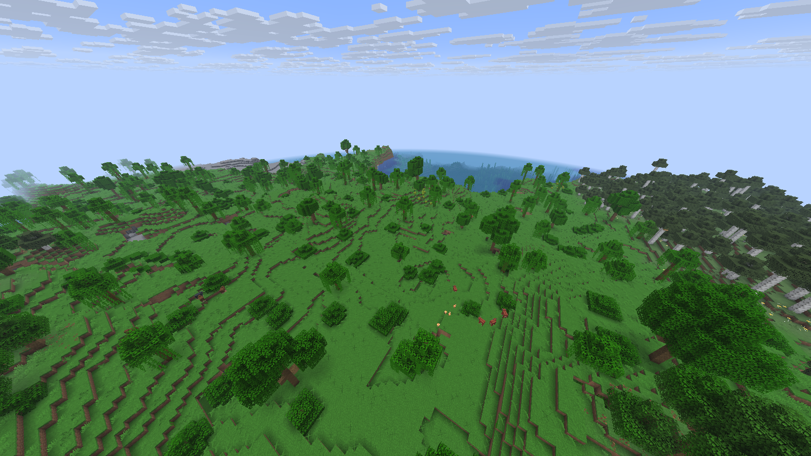
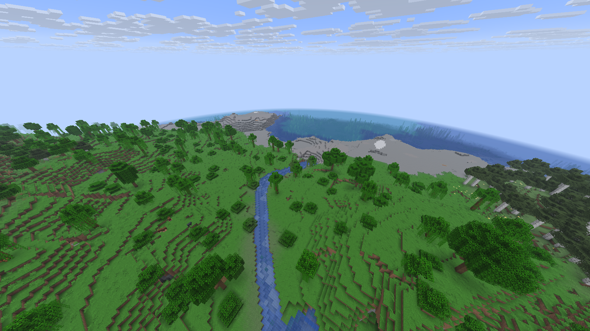
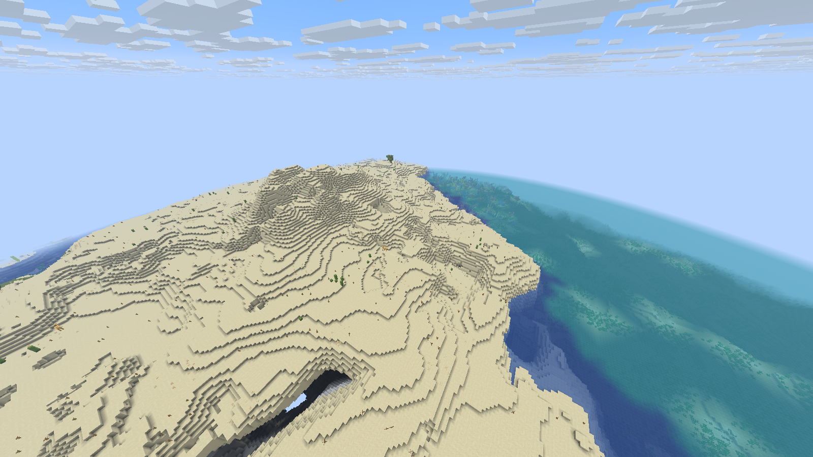
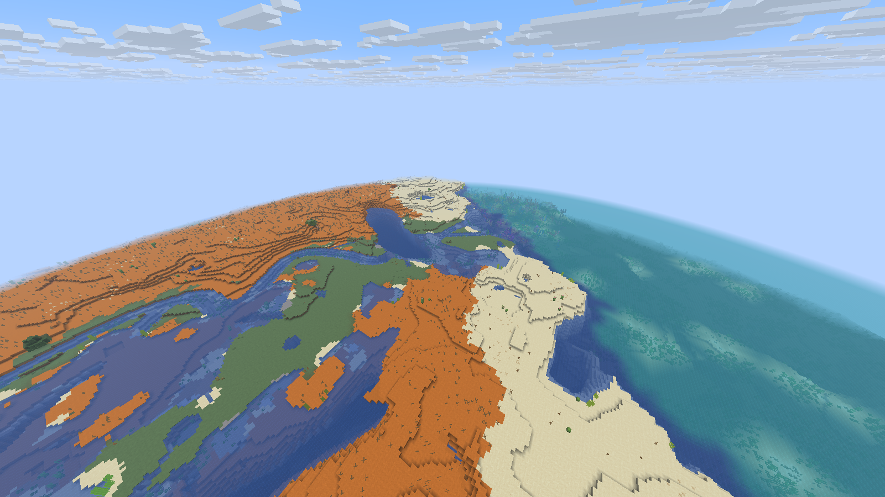
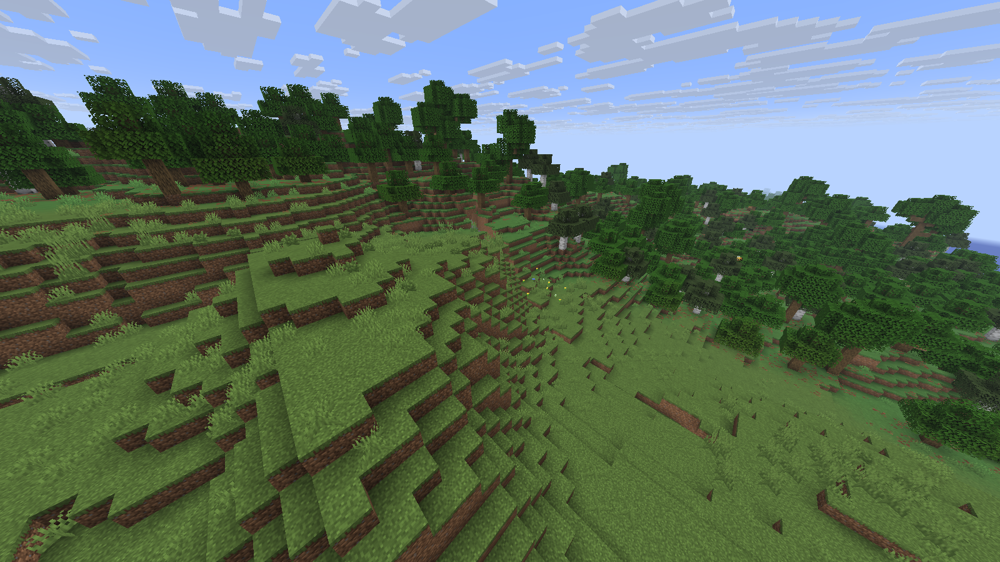
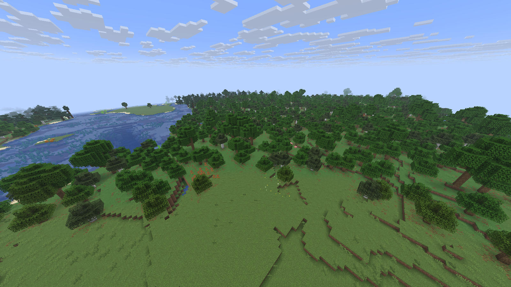

# Vanilla / Immersive Landscapes 0.6.0 comparison

Both fresh-world runs passed on frozen runtime
`4d7c4fec1e668fff43272a25696cd5ffe5b8846e78038382053e5e7b6c9e6a0c`.
All six original native PNGs were manually reviewed on10 November2026 and copied
to the repository with SHA-256 readback. This is a bounded three-location comparison,
not a statement of installation, FPS or owner aesthetic approval.

## Fixed comparison setup

Separate fresh worlds, seed `4312740467388825473`, same native executable and
cameras, actual distance16, DHoff,1600×900, configured base FOV90, noon/clear
weather, simulation12, cap60, VSyncoff and random block ticks disabled. A flying
spectator's effective FOV includes native modifiers; base90 is not necessarily
the final projection. The vanilla world has no IL recipe; the IL run verified
descriptor11/`vanilla-natural-v7`. Both runs exited cleanly.

| Scene | Camera X/Y/Z | Yaw / pitch | Current status |
| --- | --- | --- | --- |
| River valley | `[-263.5,123,-2328.5]` | `[148.4,35.8]` | Both captures reviewed |
| Coastal catchment | `[-1590.5,145,-2540.5]` | `[148.4,35.8]` | Both captures reviewed |
| Forest/plains | `[-1315.5,98,1563.5]` | `[135,28.46279]` | Both captures reviewed |

## Reviewed differences and original captures

| Scene | Vanilla | Immersive Landscapes |
| --- | --- | --- |
| River valley |  |  |
| Coastal catchment |  |  |
| Forest/plains |  |  |

- **River valley:** IL adds a continuous curved stream between vegetated slopes
  where vanilla has an unbroken slope. Block-sized steps and a broad native stone
  coast remain; this is not smooth non-voxel terrain.
- **Coastal catchment:** IL creates connected channels and low islands instead of
  the uninterrupted sandy headland. The former tall water curtain is absent in
  this view; terracotta/grass/sand boundaries remain visible.
- **Forest/plains:** IL shows an open flowered clearing and a varied tree fringe
  beside water, compared with vanilla's wooded hillside.

No obvious unsupported canopy, rectangular chunk void or disconnected water sheet
was seen in these six images. Full image hashes follow; these original files are
not edited previews.

| Image | SHA-256 |
| --- | --- |
| `0.6.0-vanilla-river-valley.png` | `118dddcfa679a23b4eab607f36efec0af0f6b6c70e953d9e8dd437d0fe586894` |
| `0.6.0-vanilla-delta.png` | `494ca559303ed3d8bfc175eea8aa9095706becfea9fca049a9dcd34704850106` |
| `0.6.0-vanilla-forest-plains.png` | `2948c45ffb4de3ed2a8871bfcb57d0f723922e0678cc6d4ceaf5c6866a1b28f3` |
| `0.6.0-il-river-valley.png` | `55b07bfc5f9b418c35bc43797807ef055d68763ceef530470db6d6bde0bf3531` |
| `0.6.0-il-delta.png` | `fabe713da037ca8c239c2f622d41ed830c0d4832427e467af70ea81c140ffdc5` |
| `0.6.0-il-forest-plains.png` | `77bd0f534eda020a08104e9c1a65fa2cc4441652baddd01d6a59f870a7bbd7d7` |

These full-mod comparisons include terrain changes and therefore do not isolate
vegetation policy alone. Cloud positions and incidental entities can differ.
Unedited screenshots are evidence of bounded locations, not FPS measurements,
all-seed quality, every biome transition or owner aesthetic acceptance.

## Separately verified current scenes

Current seed42 pond/outlet captures show a connected descending water path; nine
loaded water positions pass. Four regional vegetation captures retain native
landforms/material borders and show no obvious detached canopy in those views.
The repaired delta stays geometrically continuous through32→8→32. These are
current-runtime checks; they are separate from the matched-pair evidence above.

The diagonal ocean band visible in the delta is a native biome-color transition:
three pixel pairs correspond exactly to deep_lukewarm_ocean/warm_ocean at equal
water height and the same DH generation stage, both at native32 and native8.
Water tint interpolation is not implemented here.

QA: `RustCore/qa/completion-2026-11-08-bankfix/ab-vanilla.json`, `ab-il.json`,
`scenes-comparison.json`, `reports/visual-review-ab-partial.json`,
`visual-observations.md`, and `ocean-tint-diagnosis.json`. Final performance/handoff
image review remains separate from these completed comparison observations.

The [0.5.1 gallery](comparison-0.5.1.md) and older bfbaa93/ac2e4919 candidate
captures are historical and retain their own runtime identities.
See [current validation](validation-0.6.0.md) for the rest of the release gates.
