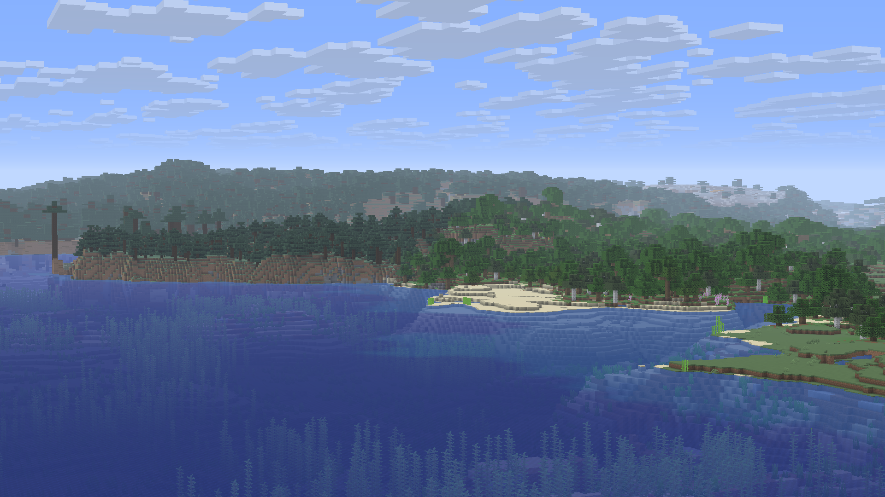
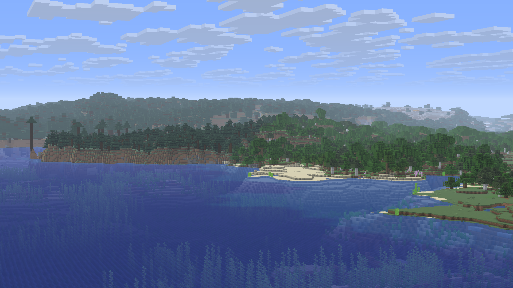
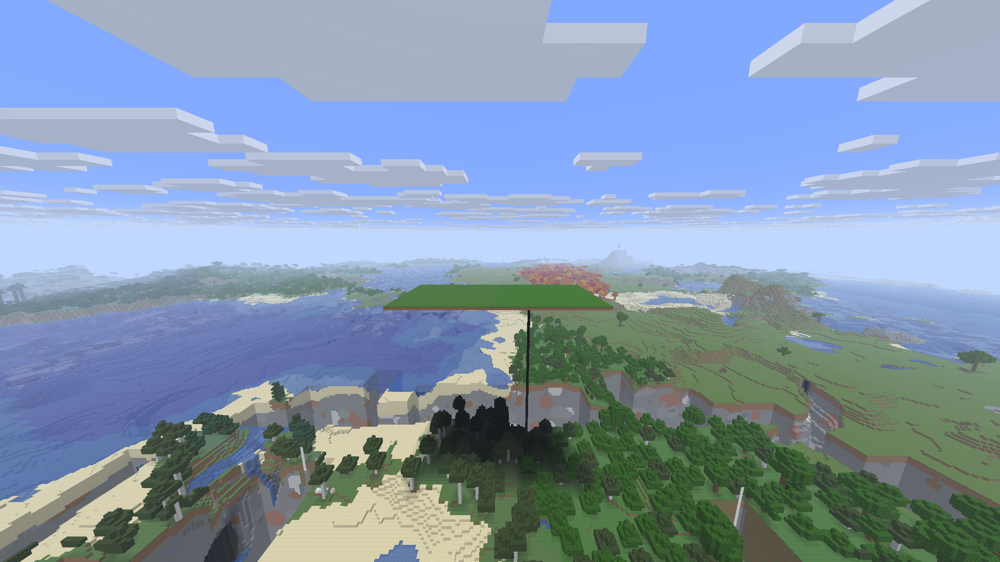
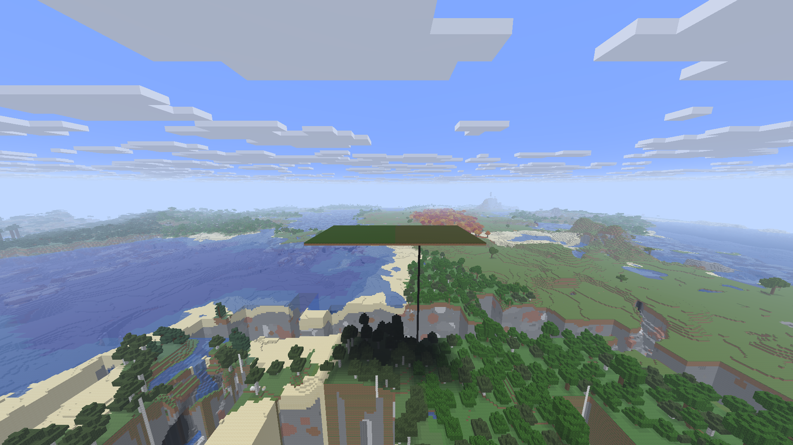

# Near-boundary detail and biome colors — 4 November 2026

Checked native set: IL 0.3.1/v2/descriptor6, DH 0.1.0+dormyu.7, unchanged official
Zoom 2.0.0, Horizon f42ef42 / Minecraft26.3. Local Rust client `7292006be9ccf7629d3e6052f799244665f413a9f02bfb9ae7ad4fd1cbc32ca4`.
This updates the separate renderer adaptation; the terrain recipe is unchanged.

Medium/High/Extreme refine a bounded band intersecting radius−32 through radius+64
blocks around the actual near radius. Low/Lowest retain their original plan.
Farther detail retains its existing quality curve. The earlier
[water/GPU/mask corrections](dh-water-parity-2026-11-04.md) remain.
The water-volume-v2 data format/fingerprint stays compatible; no full cache reset.

The bridge delegates grass color to Horizon's biome API using face-center world
coordinates. This restores dark-forest darkening and positional swamp color.
Precolored cherry/azalea/flowering-azalea/pale-oak foliage avoids an extra common tint.
Native biome blending, texture filtering and simplified vegetation can still differ.

## Same-camera boundary captures

Independent copies of the same private v5 coast and existing cache, native32 / DH128
Medium / FOV90, held4x Zoom. These are renderer comparisons, not a newly generated v6 world.
Cloud positions and asynchronous distant completion can vary between captures.

Before:

After:

## Material fixture

An explicitly edited flat grass platform splits dark forest and swamp. Both captures
below show DH at near2; the reference is the same camera with real near8 chunks.
Two fixed interior rectangles were selected from old-renderer images before candidate
captures existed. Euclidean distance between mean RGB colors fell by
98.8% and 94.7%
respectively. This measures material parity, not natural generation or zero pixel error.

## Performance and checks

Reopened copied-cache offscreen1080p/FOV90, near32/sim8/DH128 Medium/cap120,
VSync/audio off. Static8s, flight12s. CPU/GPU timings and allocation counts accompany
the FPS cap; section count alone is not a cost estimate.

| Measurement | Previous | DH dormyu.7 |
| --- | ---: | ---: |
| Static CPU average, ms | 2.10 | 2.27 |
| Static GPU average, ms | 3.07 | 3.08 |
| Flight FPS | 119.60 | 119.53 |
| Flight P99 frame, ms | 9.53 | 9.41 |
| Flight maximum frame, ms | 16.53 | 18.43 |
| GPU allocated, MB | 2195.00 | 2259.10 |
| GPU reserved, MB | 2532.00 | 2532.00 |
| Process allocator commit, MB | 4221.30 | 4215.80 |

The planning probe rises230→328 sections for Medium near32; actual resident far quads
change 5,406,894→6,039,395. This quality gain has a bounded cost;
Low/Lowest avoid the added band. These short runs do not establish cold near32,
long exploration, all-seed behavior, shader-pack parity or future heavy-pack headroom.

26 core tests / offline locked Clippy pass, including a boundary regression that fails
before the fix and all six face-direction coordinate tests. RU/EN named creation,
save/reopen, disabled-mod vanilla, unchanged v4/v5 recipe copies, dedicated Rust server
and two clients with shared block/independent Zoom input pass. Installed Prism actually
launches this client; 5127 personal save files and all captured settings
are unchanged, control is off. Teams was left running.

## Test the installed laboratory

Desktop Prism shortcut → **DormLab** → restart and open an existing world to check DH.
For a new landscape choose **Immersive Landscapes** in normal world creation; any seed.
Hold **Z**, use **Z + wheel** to adjust. Native LOD0 when DH is enabled.
Owner settings remain near32/DH128 Medium/sim8/cap260/VSync off/workers Auto.

QA: `RustCore/qa/dh-boundary-detail-2026-11-04/reports`; checked rollback preserves
client5b599bb2 at `before-boundary-detail-install`. The clean RustCore baseline is separate.

[Corresponding source set](https://github.com/dormyu/immersive-landscapes/releases/tag/dormlab-detail-2026-11-04), including all three native mods and notices;
[build tooling](native-build.md). IL/Zoom are MIT, DH LGPL-3.0-only with original
Deniz Şahin / James Seibel and contributors credited. No engine/game/user data is published.
Terrain release remains v0.3.1. Hydrology/outlets/deltas, gradual vegetation and
heavy-pack/long-route acceptance remain open; future structures target versioned IL geography.
