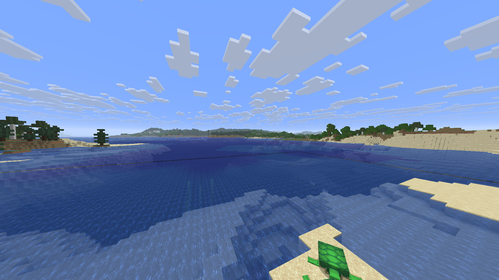
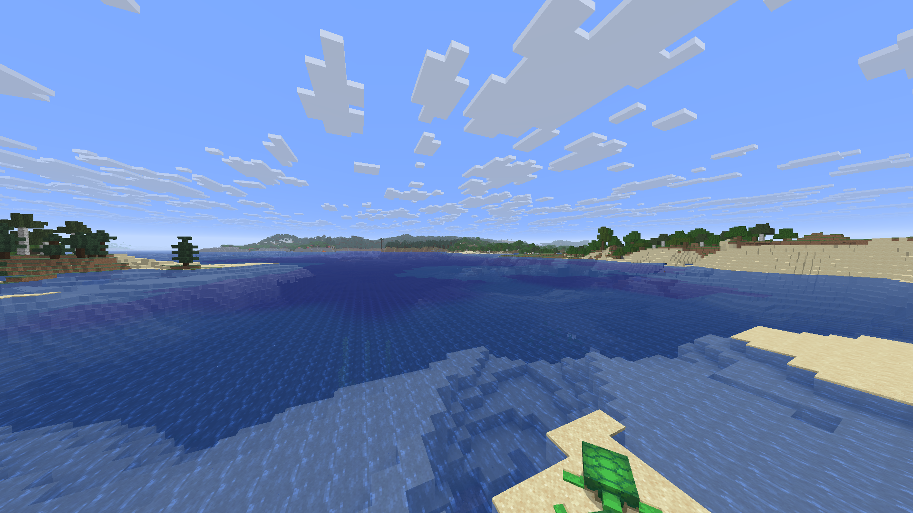

# Water and near/far handoff — 4 November 2026

The local DormLab set now uses **Distant Horizons0.1.0+dormyu.6** with unchanged
**Immersive Landscapes0.3.1 / vanilla-natural-v2 / descriptor6** and official
**Horizon Zoom2.0.0**. This iteration updates the separate DH adaptation;
terrain density functions, saved recipes and player blocks are unchanged.
Horizon remains pinned to `f42ef42ef6ceccb3c6a20bea2481d87949a51c81` / Minecraft26.3.

## Visible result

The black line at the near/far water boundary disappears in the compared scene.
Both runs use independent copies of the same saved v5 coast and existing derived
cache, the same camera502.902,68.2,-71.795 / yaw113.5498 / pitch2 / FOV90,
1080p, near2 and DH128 Medium. The deliberately short near range makes the
boundary easy to inspect. It is a diagnostic view, not the owner's near32 profile.

Before — clientc30f2439 / DHdormyu.5:

After — client5b599bb2 / DHdormyu.6:

A fixed water rectangle, x0..1919/y575..719, contains723 pixels with every RGB
channel below35 before, and0 after. This is a local measure of this black line;
it does not establish universal seamless rendering. Seabed resolution, plants
and color/detail changes are still visible at some boundaries.

## Corrections

- Cut far geometry only for near columns whose detailed section meshes are
  GPU-complete. CPU chunk arrival alone does not mean their surfaces are drawable.
- Track exact near-column masks instead of counts. Equal-sized near areas moving
  through a section must move the holes in its far mesh.
- Reject worker results made with an older mask, and keep one follow-up mesh
  request when a Section job is still active. A forced-delay regression covers this race.
- Project exposed still-fluid tops to the detailed interior height8/9 minus0.001,
  with matching upper side edges; fluid under a solid roof stays full height.
- Emit native fluid-face material tags and match the still-water top's V direction.
  Shader-pack-specific visual compatibility remains unverified.

The water-volume-v2 full-data format/fingerprint is unchanged: this update does
not force the entire DH cache to rebuild. It works in existing worlds. Existing
terrain recipes are preserved; creating a new world is only needed to select a
new generation recipe, not to use this rendering correction.

## Verification

- 23 core tests pass; offline locked Clippy passes with warnings denied.
  Two new regressions fail before the fixes; the third controls a delayed worker.
- Actual near range32 →8 →2 →16 →32, movement and a continuous near32 flight.
  Both comparison processes exit0 and the source QA world/cache files stay identical.
- Normal RU/EN **Immersive Landscapes** creation, exact7 overrides +2 private
  resource aliases, edited-block save/reopen, disabled-mod vanilla creation.
  Saved v4 and v5 recipe copies remain byte-identical (94 and9 files).
- A Rust dedicated server and two actual Rust clients share an emerald-block
  update and DH geometry, keep independent held-Z/wheel Zoom behavior, report
  zero decode errors and all exit0. This near2 loopback smoke does not prove
  remote far-loading quality or multiplayer performance.
- Installed Prism → RustCoreBridge → updated native executable observed.
  New v6 world, control off, all 3779 original save files and personal settings preserved.

## Bounded performance check

New binary only: copied/reopened world with existing derived cache,
offscreen1920×1080/FOV90, near32/simulation8/DH128 Medium,
cap120, VSync/audio off, offscreen inactivity pacing disabled.

| Route | Duration | Average FPS | P99 frame | Maximum frame |
| --- | --- | --- | --- | --- |
| Stationary coast |8s |119.99 |9.34ms |11.36ms |
| Coast flight |12s |119.62 |9.65ms |14.77ms |

These short runs are not cold near32 generation, long exploration or heavy-pack
acceptance. They do not establish a general speedup against the previous build.
The owner's actual cap260/VSync-off/near32 profile is preserved.

Build: one Cargo job, fast profile with per-package horizon-client O2,
64 codegen units, incremental=false; existing optimized fast engine libraries.
Build921.2s, minimum available physical RAM2.04GiB, all project caches/temp on E:.

Client SHA256: `5b599bb22168defe0a6d0fb7339eb71007e6cb8a4b526f24309a7559af97c539`.
Built DH code: `0807fc6`; corresponding DH source archive: `c1b70df`.
IL source snapshot: `aaa4a0b`, terrain code`0e86afb`, unchanged bundle SHA256
`7091ca5d96b9d7f7f00015bd4e3c9d0f18d07958c31de82dd8f8df98f3a3df00`.
Zoom source: `725ff7a`, unchanged official2.0.0/MIT code.

## Run and remaining work

Local owner: desktop Prism → **DormLab** → open an existing world for the DH
fix, or create a new **Immersive Landscapes** world for the current terrain recipe.
Hold **Z**, turn the wheel while held to adjust Zoom. Keep native LOD Distance0
when using DH. No manual/prepared map is required.

[Corresponding native-source set](https://github.com/dormyu/immersive-landscapes/releases/tag/dormlab-2026-11-04)
includes the separate licensed mod sources/bundles, checksums and build notes.
These are source mods compiled into pinned Horizon; no combined executable,
game assets, prepared resources, accounts or worlds are distributed.
[Build tooling](native-build.md) requires the documented patched mixins tool.

Remaining: seabed/material/detail transitions, sustained exploration and older-PC
profiles, full catchments/outlets/deltas and gradual vegetation transitions.
This patch does not implement new structures or a replacement renderer.
Working-mod status is retained; owner review of this new visual result is pending.

Credits: dormyu adaptation; Deniz Şahin/contributors — original Rust port;
James Seibel/contributors — original Distant Horizons. DH remains LGPL-3.0-only;
Immersive Landscapes and Zoom retain their own MIT licenses and notices.
