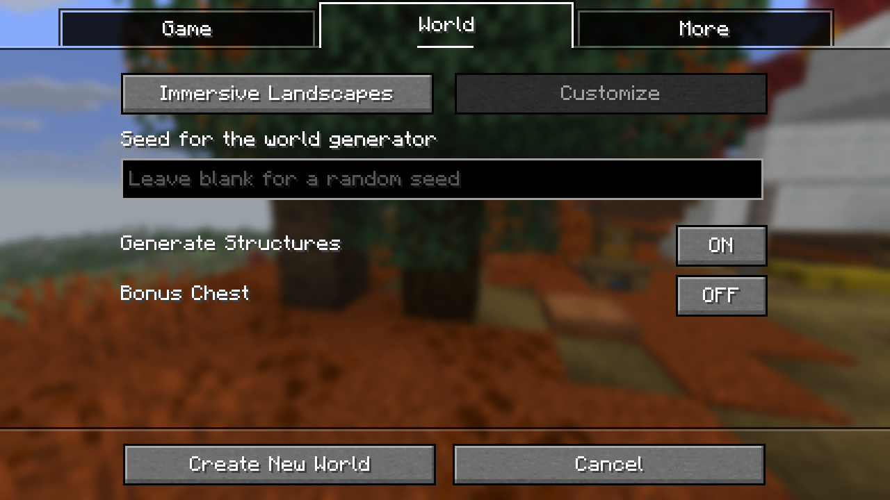

# Named world type — 2 November 2026

This update changes creation-screen presentation only. The earlier statement
of owner acceptance was withdrawn on 3 November after identifying a different
launcher instance; see [the correction](feedback-correction.md). Here,
the normal-generation slot is named **Immersive Landscapes** while the mod is
enabled. It keeps the same saved-world identity, descriptor4 and epic-compact-v1.

## Verified with the compiled native game

- Full name fits the existing world-type button in Russian and English.
  Other world types still cycle normally, including Superflat.
- Creating a fresh world through the UI installed descriptor4. All94 world-local
  preset files matched the previous v4 candidate recipe byte for byte. No chunk decode errors.
- Disabling the mod through Options restored Default. A fresh world created
  while disabled did not receive the IL marker or generator.
- A copy of a world created by the previous installed version opened with49
  chunks and zero decode errors. Its descriptor and94 preset files were unchanged.
- A fresh native dedicated server and two Rust clients received the same world
  and emerald-block update. Both clients had49chunks, no decode errors and actual
  DH geometry. Both clients and the server exited with code0.
- The UI test exited with code0, including its English-language restart.

This was functional QA with low near distance, not a new performance benchmark
or a claim that all distant sections finished loading. The earlier measured
conditions and acceptance correction are recorded in [v4 validation](validation-0.2.0-dev.1.md).
There is no new gameplay-frame hook or generation work in this UI update.

Runtime SHA-256:
`4082f8258bf417115082b136244a8ab5c4c582fe24c0d045f756ffb279f0210c`.
Horizon c9d474d, patched mixins19140348, unchanged DH adaptationb64902c.
One Cargo job; optimized fast build completed in17m17s.

Local detailed reports: `RustCore/qa/immersive-landscapes-2026-11-02/reports/`:
`immersive-named-world.json`, `immersive-named-two-clients.json` and
`owner-acceptance-v4.json` (invalidated: wrong-instance attribution, not QA).
Earlier failed harness attempts were retained:
one used too short a synchronous creation timeout; another used world-only
key control to leave a title-menu page. The corrected harness uses the real
Done buttons. Neither required changing the compiled game.

Installed Prism readback, settings preservation, hashes and rollback are recorded
separately in the local DormLab `rustcore/native-build.json`; source availability
alone does not establish which executable a launcher is using.
