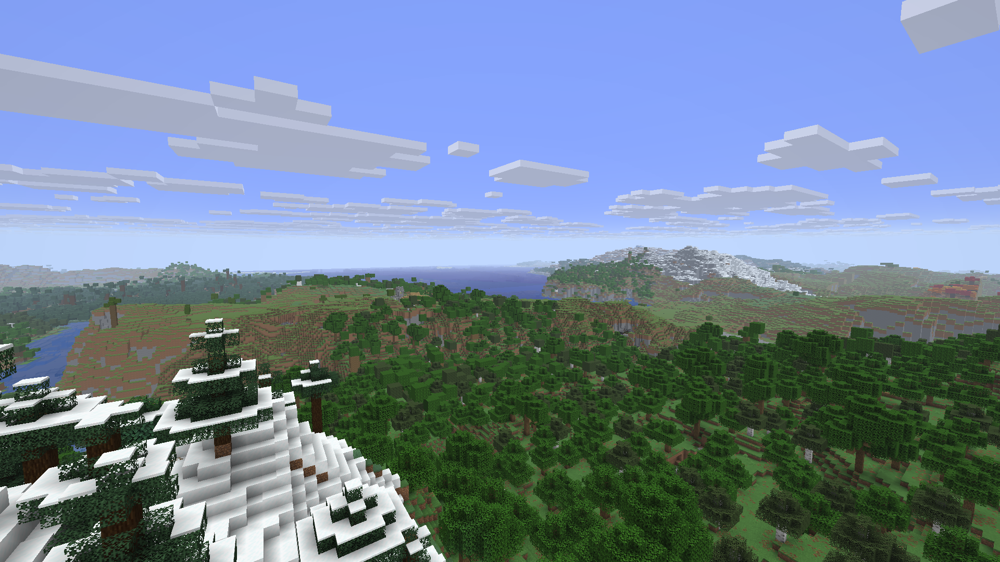

# Validation: 0.3.0-dev.1, 3 November 2026

Candidate vanilla-natural-v1 / descriptor5, not owner acceptance.
Horizon c9d474d / Minecraft26.3, separate DH adaptation b64902c, mixins19140348.
Native Windows executable SHA-256: `610c4105950a6dc362ad0cba482229fbd0baf0c011f3cbf570820356e8fac5d6`.

## Functional checks

- Real Russian/English new-world UI: Immersive Landscapes, other type cycling,
  disabling the mod restores Default. A new seed world received descriptor5.
- All eight bundled recipe files matched the world's copy byte-for-byte; the
  ninth, private vanilla offset alias matched the owner's prepared resources.
- An emerald block persisted after closing/reopening the new world. A vanilla
  world created with IL off had no marker. A copy of old v4 opened and retained
  all94 recipe files and its marker. All native processes exited0.
- Dedicated Rust server + two Rust clients, seed482193, near2, loopback25582:
  both received49 chunks, shared a block update, decode_errors0, DH geometry
  on both; all three processes exited0. This is not a network/load benchmark.
- Regeneration of the JSON and embedded Rust source was byte-identical.
  Rust formatting and Git whitespace checks passed. No gameplay-frame hook added.

## Same-seed rendering and movement

Windows, i5-9400F / RTX2060 /16GiB. **Offscreen1920×1080**, near16, simulation8,
maxFps120, VSync off; built-in Horizon LOD off. DH128/medium in its run only.
Seed -6712665269073713615, fresh independent worlds. Mountain camera
(-1100,160,550), yaw180/pitch3; 12-second flight to(-800,140,100).
8-second settled sample. Each launch settled >900 near chunks and zero pending.

| Mode | Initial load seconds | Settled FPS | Flight FPS | Flight P99 ms | Flight max ms |
| --- | ---: | ---: | ---: | ---: | ---: |
| vanilla | 15.3 | 115.4 | 109.9 | 18.75 | 44.45 |
| natural | 13.6 | 115.7 | 109.7 | 18.72 | 23.02 |
| natural-dh | 14.7 | 115.9 | 110.1 | 18.54 | 23.30 |

These short sequential measurements do not establish visible VSync gameplay,
near32/120, every seed, or headroom under the future heavy pack. There is no
statistical claim that IL is faster than vanilla. Frame pacing is close in this
sample; cold generation and worst cases still require wider coverage.

During the first DH observation the engine's AFK limiter capped later samples
at30FPS after a minute without physical input. CPU/GPU times were below that
frame interval. That run is archived, excluded from the performance table, and
DH was rerun in a **fresh world** with inactivityFpsLimit:minimized. The other
runs finished their measurements before the idle cap. Future harness runs set
the same idle option for every mode. Owner options were not changed.

After60seconds of observation following the initial mountain capture, DH reported
**291/291 sections drawn, zero queued jobs**, about5.33million faces. Near/DH
screenshots were inspected; extended distant coverage appears and foreground
geometry agrees in these views. This is not exhaustive agreement testing or a
claim that all water/material artifacts are fixed. The DH code was not changed.

## Native generation probes

4225 samples per seed, 64-block spacing across a4096-block square, using the
actual pinned native generator. Six actual generated chunks were also sampled
per run. No unsupported generator features or override warnings were reported.

| Seed | Vanilla biome count | Vanilla sampled peak | IL biome count | IL sampled peak |
| --- | ---: | ---: | ---: | ---: |
| -6712665269073713615 | 46 | 175 | 46 | 185 |
| 8675309 | 37 | 160 | 33 | 162 |
| 482193 | 36 | 160 | 33 | 145 |

Counts and heights describe these samples, not every spawn. They verify neither
full river connectivity nor seamless ecological transitions.

## Delivery evidence and remaining limits

The candidate is packaged only after these checks. Exact installed commit,
rollback, saved-world/settings hashes and **actual Prism launch readback** are
recorded locally in `RustCore/packs/DormLab/rustcore/native-build.json` and
`RustCore/qa/immersive-landscapes-2026-11-03/reports`. Do not infer installation
from this source document alone. Delivered control stays disabled.

Noise valleys are not a validated watershed/outlet/delta network. Vanilla
vegetation and biome identities still have discrete boundaries. Visual acceptance,
heavy-pack performance and final geography for future custom structures remain
open. Existing user worlds retain their own generator; test this recipe in a new
world named/type Immersive Landscapes in **DormLab**, not DormLab-EpicReference.

The first build's UI check found CRLF/LF checksum drift. The preset now enforces
LF at generation and Git boundaries; native.py validates checksums before
embedding. The rebuilt candidate passed exact source-to-world comparison.
