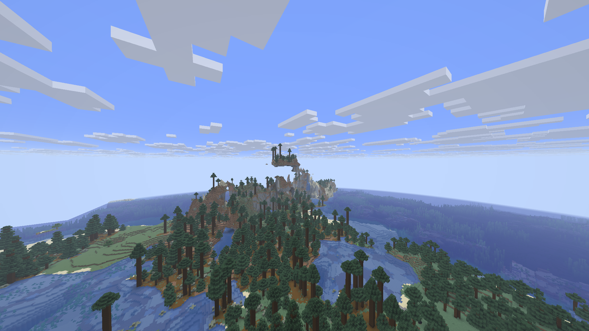
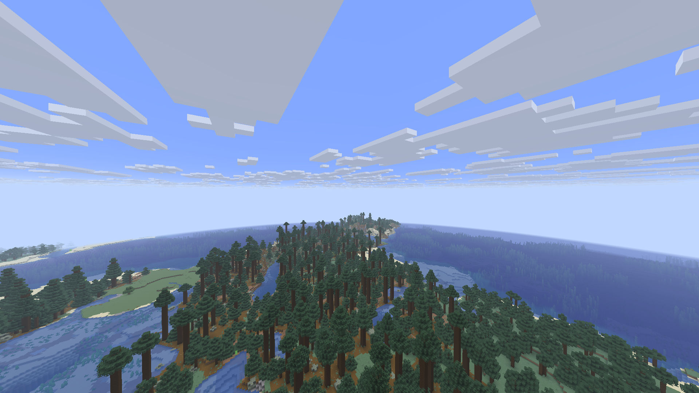
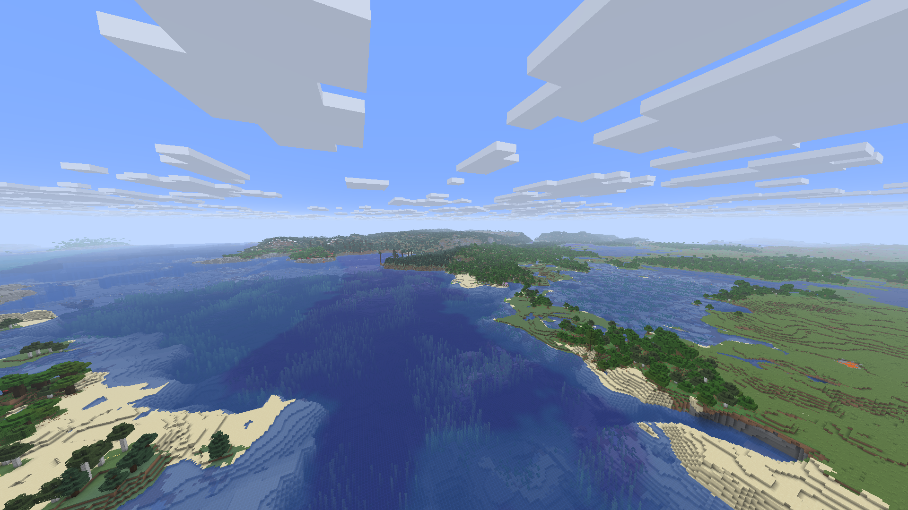
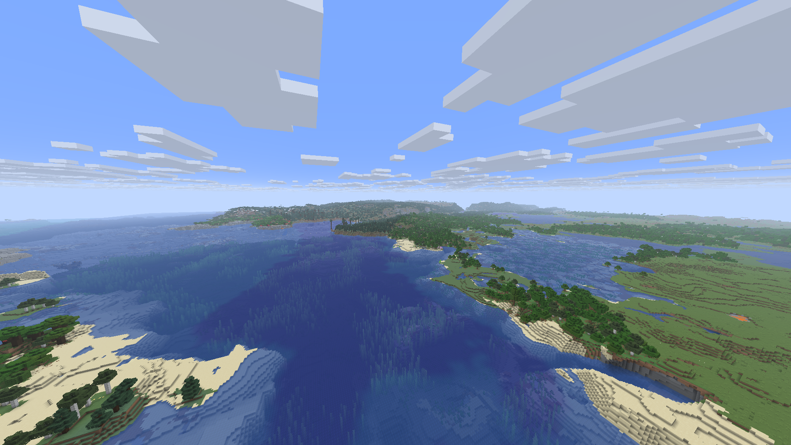

# Immersive Landscapes0.3.1 verification

Working native mod, actively developed by dormyu. Horizon f42ef42 / Minecraft26.3;
vanilla-natural-v2 / descriptor6. Combined with separate DH0.1.0+dormyu.5 and
unmodified official Horizon Zoom2.0.0 (725ff7a). Built terrain code:0e86afb;
built DH code:abae49b; one Cargo job, optimized fast profile, all project storage E:.
Client SHA256: `c30f2439c44ed7fa79e18204c9479a4a200c55d388f0f4d4afb0311075a44623`. The first incremental build hit the RAM guard and
was stopped, as did a second attempt. The successful build reuses its mixed
stage with per-package horizon-client overrides: incremental=false, opt-level=2,
codegen-units=64. Other compiled engine libraries keep their existing optimized
fast profile. One Cargo job and the memory guard remain enabled; runtime
performance is measured below rather than inferred from compiler flags.

## Generation regression

The reported floating stone mass reproduced without DH in fresh generation of
seed6719129005571520046. Reducing only base_3d_noise amplitude to0.35 removes
that observed mass. Camera:-237.080,145.340,616.849 / yaw123 / pitch1 / FOV90;
32 native chunks, DH disabled in both images. The earlier scene in seed
-6712665269073713615 was also compared; woodland and the snowy hillside remain.
These samples do not establish that every seed has no detached blocks.

Before (same-seed fresh v1 world):

After (new v2 world created by the compiled mod):

## Functional checks

- Real RU/EN creation UI displays Immersive Landscapes. Cycling world types works.
- Normal creation embeds seven exact registry overrides plus two aliases from
  private prepared resources; descriptor6/v2. No biome or dimension replacement.
- An edited emerald block persists after save/reopen. Disabling IL restores
  ordinary new-world generation. Copied v4 and v5 worlds keep exact saved recipes.
- Native dedicated loopback server and two Rust clients receive the same new
  world and block edit, DH geometry, zero decode errors. All three exit0.
- Zoom Z/wheel claim and release work independently in both clients.

## Water correction in the separate DH adaptation

Two regression tests failed before the fix and pass afterwards: internal water
walls across biome mapping IDs and gaps around ignored submerged plants.
All20 core tests pass; Clippy passes with warnings denied. Standard submerged
plants are projected as contained water in far geometry. Surface tints remain
distinct and real air/shore edges remain visible. The derived-cache fingerprint
changes, so existing far caches rebuild without changing gameplay blocks.

Water A/B uses independent copies of the SAME saved v5 world and the same coast
camera; no generation retune is applied to that world. Captures at30/60/90s are
kept locally. A nonzero far mesh is not proof of zero seams. Remaining
fractional fluid-level/material differences require further observation.

Before (local DHdormyu.4,90s, cold derived cache):

After (local DHdormyu.5, same saved world/camera/settings/90s):

Large extra water walls at the left of the view disappear. The detail transition
over the seabed remains visible in places; this is a partial visual correction.

## Scoped frame diagnostic

Reopened QA copy after cold90s comparison, existing new-fingerprint DH cache; near32/DH128 Medium/sim8/cap120/FOV90, offscreen1080p/VSync off/audio off. Cold-derived-cache captures and their separate frame diagnostic
are in water-after.json; the following values are for the reopened warmed copy.
Static8s: 119.76FPS / P99 9.79ms / max 13.82ms.
Flight12s: 118.39FPS / P99 12.85ms / max 20.59ms.
This is a short local check, not a heavy-pack or long-exploration guarantee.

Full drainage networks/deltas and gradual vegetation transitions remain open.
The installed Prism readback is recorded separately after installation in
the local manifest. Raw evidence: RustCore/qa/dh-handoff-2026-11-03/reports.
