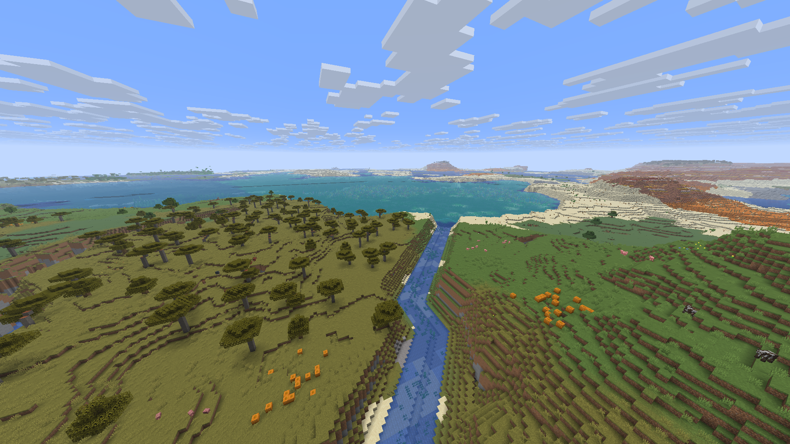
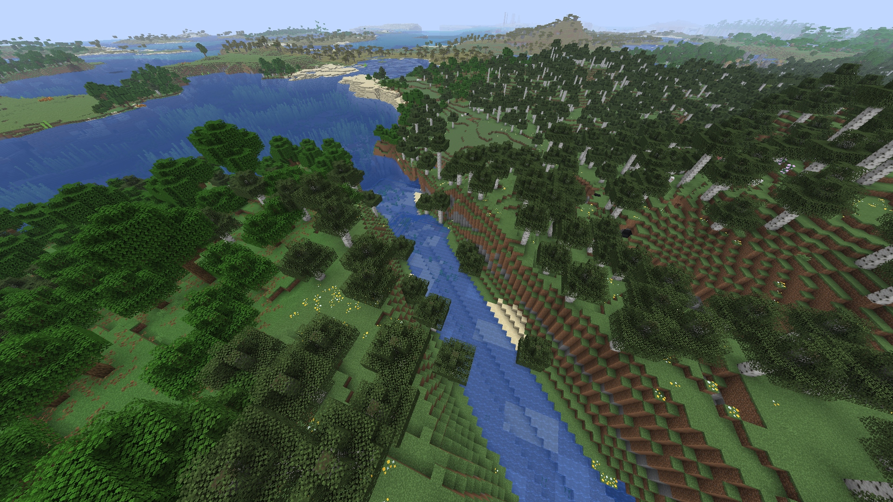

# Version 0.4.0 validation — 5 November 2026

Pinned Horizon f42ef42 / Minecraft 26.3; IL0.4.0/v3/descriptor7, unchanged DH7 and
official Zoom 2.0.0. Checked local client `add9b6a55dab0fae1b76dae5be395a7076a61ef7618515209edbbce0b7fee62d`. Built Rust code
16250c2; later source commits update documentation only. Author dormyu.

## Functional checks

- 22 calculation tests/Clippy pass; ten test the actual native watershed/span
  support modules. Windows/Linux stable and Linux MSRV1.88 CI pass.
- Actual native generator: three seeds 42, 9072026 and -19477, identical near/far
  beds/water/liners, roof trimming, grid/column order and two generation workers.
- Explicitly empty disk caches and separate process reopen produce identical
  block/LOD points; bad/seed/recipe cache invalidation also has pure regression tests.
- Selected full-strength river centrelines: 3093/3093 wet points across
  901 TERRAIN-status chunks, zero missing profiles.
  This does not validate every shore, lake, decoration or seed.
- Normal RU/EN world-type menu, new v7 creation, emerald save/reopen, disabled-mod
  vanilla creation, vanilla retention after re-enable and old v4/v5/v6 recipes pass.
- The ordinary new game contains real water after native decoration and ticking.
- Rust dedicated server and two clients, loopback/near2, shared block, independent
  Zoom and remote far geometry pass. No normal-chunk decode errors or far transport
  warnings in this session. It is a functional smoke, not server load acceptance.
- Installed Prism → bridge → exact native executable, control off, fresh QA world,
  temporary near2 for launcher integration; near32 performance is a separate run.
  5127 owner save files and personal settings remain unchanged.

The first network smoke incorrectly passed despite far-span warnings. That result
is revoked and retained in the QA archive. The native adapter now keeps top-first
runs; the client reverses them into bottom-first wire columns. Strict rerun passes.

## Same seed/settings diagnostic

Independent newly created v6/v7 worlds, seed42, same camera, native32/DH128 Medium,
sim8/FOV90/cap120/offscreen1080p/VSync and audio off. No full build or competing
game ran during the measurements. The early sample immediately follows a long
teleport and can include unloaded terrain; it is excluded from performance
acceptance. Initial playing means the first spawn chunks, not full near32 or
whole world preparation. The paired static/flight samples follow actual chunk
completion and an additional 60 seconds of far preparation.

| Measurement |0.3.1/v6 |0.4.0/v7 |
| --- | ---: | ---: |
| First spawn chunks, seconds (not full preparation) | 6.45 | 5.16 |
| Warm static FPS | 119.39 | 120.00 |
| Warm static CPU average, ms | 2.23 | 2.19 |
| Warm static GPU average, ms | 3.21 | 3.15 |
| Flight FPS | 119.88 | 119.91 |
| Flight P99, ms | 8.99 | 8.85 |
| Flight maximum, ms | 14.01 | 13.72 |
| Uncapped diagnostic FPS after flight | 362.05 | 358.57 |

Short diagnostics cannot establish long-route/older-PC/heavy-pack headroom.
Personal maxFps260 (unlimited)/VSync off/near32 remains unchanged; benchmark cap120 is separate.

Focused actual-game river view, near32/DH128, not a performance sample:

## Open work

Bounded coastal domains only: not every noise valley becomes a connected river.
Full inland catchments, delta branches and gradual biome vegetation are unfinished.
DH vegetation/material/detail transitions can still differ. Owner acceptance of
this exact new version remains pending; the historical mistaken v4 acceptance
is still revoked. Existing v4/v5/v6 recipes are never silently migrated.
The matched low coast view also reproduces distant upright artifacts on the
prior 0.3.1 runtime. This hydrology delivery does not fix those renderer defects.

QA and rollback: RustCore/qa/hydrology-v3-2026-11-04, before-hydrology-install.
No game assets, engine executable, accounts or worlds in the public source kit.
